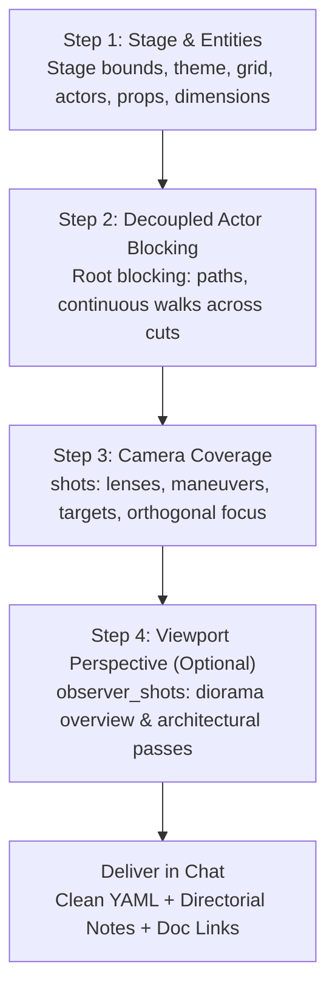

# StageFlow Choreography Score Creator & Directorial Mentor Skill

This skill guides the agent in **authoring, scaffolding, explaining, and teaching** StageFlow YAML choreography scores (`*.yaml`).

---

## 1. Core Operating Boundaries (Strict Rules)

### Rule 1: Zero Codebase Inspection (Documentation Only)
- **NEVER** read, inspect, or dissect source code files under `src/` (e.g. `src/core/`, `src/stage/`, `src/hooks/`, `src/ui/`).
- The engine implementation details are irrelevant to authoring scores.
- All schema contracts, parameters, enums, optics formulas, defaults, and architectural invariants must be sourced **EXCLUSIVELY** from the living documentation:
  - [**`docs/YAML_AUTHORING_GUIDE.md`**](../../../docs/YAML_AUTHORING_GUIDE.md): Authoritative authoring SSOT, parameters, defaults, and 8 production recipes.
  - [**`docs/STAGEFLOW_SCRIPT_SPECIFICATION.md`**](../../../docs/STAGEFLOW_SCRIPT_SPECIFICATION.md): Mathematical model, coordinate systems, optics, and normalized AST contract (§7.2).
  - [**`docs/SCORE_CATALOG.md`**](../../../docs/SCORE_CATALOG.md): Canonical catalog of bundled study and blueprint scores.

### Rule 2: Scores Are Temporary (Never Touch Repo Files)
- **NEVER write or save generated scores into the repository** (e.g. do not create or modify files in `src/scores/` or write `.yaml` files to the project directory).
- Output the generated YAML score **directly in the chat** formatted inside a clean markdown YAML code block.
- Instruct the user to copy-paste the score directly into **StageFlow's live in-browser YAML Drawer / Editor** in the web app, which persists safely in browser state (`IndexedDB` / drafts) without dirtying git.

### Rule 3: Teach & Explain (Co-Authoring Mentorship)
- The goal is not just to dump code, but to **help the user understand and master StageFlow score authoring**.
- When generating or reviewing a score, provide concise directorial notes explaining **why** key decisions were made (e.g. why `blocking:` decouples actor walks from camera cuts, why `focus: "<id>"` uses orthogonal projection, or why specific lens focal lengths were chosen).
- Link directly to the relevant sections of [`docs/YAML_AUTHORING_GUIDE.md`](../../../docs/YAML_AUTHORING_GUIDE.md) so the user can easily explore deeper.

### Rule 4: Standalone Execution (No Debugger Dependency)
- Author scores cleanly with proper continuous kinematics and derivative matching from the start.
- Do not chain into or require `stageflow-score-debugger`.

---

## 2. The 4-Step Directorial Composition Workflow

When a user provides a concept, script excerpt, storyboard beat, or asks to learn how to stage a scene, walk through these 4 steps:

### Step 1: Stage Geometry & Entity Cast
- **Stage Setup (`stage:`)**: Define dimensions (`width`, `depth`), metric grid lines, and visual theme (`dark`, `warm`, `light`).
- **Entity Cast (`entities:`)**: Define characters and key props with:
  - Clear semantic IDs (`id: "detective"`, `id: "witness"`, `id: "table"`).
  - Badges & roles (`badge: "DET"`, `role: "character"` or `"prop"`).
  - Color styling (`color: "#60a5fa"`).
  - Realistic dimensions (`size: [w, h, d]` or `size: [w, d]`):
    - Standing human: `height: 1.7m`, `radius: 0.25m` (or `size: [0.5, 1.7, 0.3]`).
    - Seated human: `height: 1.2m`.
    - Conference / interrogation desk: `size: [2.0, 0.75, 1.0]`.
  - Initial position `[x, y, z]` and facing rotation `rotation: 0deg` ($0^\circ$ faces downstage $+Z$).

### Step 2: Decoupled Actor Kinematics (`blocking:`)
- **Golden Rule**: Always stage continuous actor movement in the root `blocking:` block, **not** inside `shots[].entities`.
- **Why**: Putting actor paths in root `blocking:` gives actors Option A continuous ground movement trails and lets them walk smoothly across multiple camera cuts without resetting or stopping.
- Author cues with:
  - Explicit timing (`start: 0.0`, `end: 8.0` or `duration: 8.0`).
  - Target destination `position: [x, y, z]`.
  - Dynamic facing (`look_at: "witness"` or `look_at: ["actor_a", "actor_b"]` for conversational midpoint).
  - Easing curve (`cruise` or `smooth` for natural walking momentum).
  - For jump cuts or immediate relocations without ground trails, set `cut: true`.

### Step 3: Cinematic Camera Coverage (`shots:`)
- **Optics & Focal Lengths**:
  - `24mm`: Expansive wide, environmental scale, deep spatial feel.
  - `35mm`: Natural wide-angle narrative baseline.
  - `50mm`: Human eye natural perspective, dialogue coverage.
  - `85mm`: Intimate portraits, compressed space, shallow depth of field.
- **Orthogonal Focus Tracking**:
  - Use `focus: "<entity_id>"` or `focus: ["actor_a", "actor_b"]` so the engine projects $(\vec{P}_{\text{focus}} - \vec{E}) \cdot \hat{F}$ orthogonally onto the optical axis, keeping the subject pin-sharp even off-axis.
  - Set thin-lens DoF via `dof: shallow` ($f/2.0$), `medium` ($f/4.0$), or `deep` ($f/8.0$), or explicit `aperture: 2.8`.
- **Aiming & Anchors**:
  - `target: "<id>"`: Follows an entity.
  - `target: ["actor_a", "actor_b"]`: Dynamic two-shot centroid tracking midpoint.
  - `from: "<id>"`: Smooth look-at pan/transition from one subject to another.
  - `target_offset: [x, y, z]`: Metric framing adjustments (e.g. `[0, 1.4, 0]` for head height).
- **Maneuvers & Continuous Kinematics**:
  - `static`: Stationary locked camera.
  - `pan`, `tilt`, `push`, `pull`, `truck`, `pedestal`: Linear single-axis moves.
  - `arc`, `swoop`: Curved orbits around the subject (tune `breathe: 1.0` or `1.01` to prevent unwanted bulges).
  - `orbit`: Continuous orbital rotation around target.
  - `spline`: Multi-waypoint Catmull-Rom path for continuous fluid master shots.
  - Use `continuous: true` when a shot should seamlessly inherit the previous shot's exit camera position and orientation.

### Step 4: Decoupled Diorama Perspective (`observer_shots:`)
- Optionally provide cues for the diorama overview camera (Scripted Observer View) if the scene benefits from an elevated or architectural vantage point.

---

## 3. Quick Reference Index (Documentation Pointers)

Refer directly to these sections in the SSOT documentation for full details without needing to duplicate tables:

| Concept / Task | Authoritative Document & Section |
| :--- | :--- |
| **Coordinate System & Metric Axes** | [`docs/YAML_AUTHORING_GUIDE.md §1.2`](../../../docs/YAML_AUTHORING_GUIDE.md#12-coordinate-system--metric-conventions) |
| **Root Score Keys & Metadata** | [`docs/YAML_AUTHORING_GUIDE.md §3.1`](../../../docs/YAML_AUTHORING_GUIDE.md#31-root-keys-reference) |
| **Stage Geometry & Theme Options** | [`docs/YAML_AUTHORING_GUIDE.md §3.3`](../../../docs/YAML_AUTHORING_GUIDE.md#33-stage-geometry--baseline-cameras-stage) |
| **Entity Dimensions, Chevrons & Colors** | [`docs/YAML_AUTHORING_GUIDE.md §3.4`](../../../docs/YAML_AUTHORING_GUIDE.md#34-scene-entities-entities) |
| **Full Camera Cue Field Reference** | [`docs/YAML_AUTHORING_GUIDE.md §4.1`](../../../docs/YAML_AUTHORING_GUIDE.md#41-master-camera-cue-field-reference) |
| **Aiming, Look-At & Two-Shot Centroids** | [`docs/YAML_AUTHORING_GUIDE.md §4.2`](../../../docs/YAML_AUTHORING_GUIDE.md#42-aiming--anchors-target-from-target_offset) |
| **Maneuver Catalog & Arc Breathe** | [`docs/YAML_AUTHORING_GUIDE.md §4.3`](../../../docs/YAML_AUTHORING_GUIDE.md#43-maneuver-catalog) |
| **Easing Profiles & Velocity Curves** | [`docs/YAML_AUTHORING_GUIDE.md §4.4`](../../../docs/YAML_AUTHORING_GUIDE.md#44-easing-velocity-profiles) |
| **Lens Optics, Field of View & DoF** | [`docs/YAML_AUTHORING_GUIDE.md §4.6`](../../../docs/YAML_AUTHORING_GUIDE.md#46-optics--vertical-field-of-view-reference) |
| **Multi-Waypoint Catmull-Rom Splines** | [`docs/YAML_AUTHORING_GUIDE.md §4.7`](../../../docs/YAML_AUTHORING_GUIDE.md#47-catmull-rom-multi-waypoint-spline-maneuver-spline) |
| **Physical Rigs (Tripod, Dolly Track)** | [`docs/YAML_AUTHORING_GUIDE.md §4.9`](../../../docs/YAML_AUTHORING_GUIDE.md#49-physical-camera-rigs-tripod-dolly-track--spline-track) |
| **Pose Inheritance (`continuous: true`)** | [`docs/YAML_AUTHORING_GUIDE.md §5.2`](../../../docs/YAML_AUTHORING_GUIDE.md#52-pose-inheritance-standard-vs-continuous-mode) |
| **Decoupled Actor Blocking (`blocking:`)**| [`docs/YAML_AUTHORING_GUIDE.md §6.1`](../../../docs/YAML_AUTHORING_GUIDE.md#61-decoupled-actor--prop-blocking-blocking) |
| **8 Production Recipes (OTS, Dolly-Zoom, etc.)** | [`docs/YAML_AUTHORING_GUIDE.md §7`](../../../docs/YAML_AUTHORING_GUIDE.md#7-directors-cookbook-8-production-recipes) |
| **Formal AST Normalized Schema Contract** | [`docs/STAGEFLOW_SCRIPT_SPECIFICATION.md §7.2`](../../../docs/STAGEFLOW_SCRIPT_SPECIFICATION.md#72-normalized-ast-schema-contract) |

---

## 4. Educational Mentoring Guidelines (How to Help the User Learn)

When generating scores or answering questions, structure your response to empower the user:

1. **Provide the Clean Score**: Output valid, formatted YAML that can be directly pasted into the web app's YAML drawer.
2. **Highlight the Architectural Anatomy**:
   - Point out the separation between `blocking:` (actors) and `shots:` (camera).
   - Point out optical choices (lens millimeters, aperture/focus).
3. **Explain Common Gotchas**:
   - *Angles*: Always human degrees (`pitch: 15deg`, `yaw: -45deg`).
   - *Coordinates*: $Y$-Up ($0\text{m}$ is floor; actor head level is $+1.4\text{m} - +1.7\text{m}$).
   - *Targeting*: Use entity IDs rather than hardcoding static numbers whenever possible so camera motion dynamically tracks performer blocking.
   - *Continuous Chaining*: Mention `continuous: true` when authoring continuous camera moves so the user doesn't have to calculate identical exit/entry coordinates manually.
4. **Offer Iteration Ideas**: Suggest next steps (e.g. *"If you want a more intimate feel, we can swap the 35mm lens to an 85mm with shallow DoF; or if you want the detective to pace around, we can add a secondary blocking waypoint from 5s to 9s"*).
