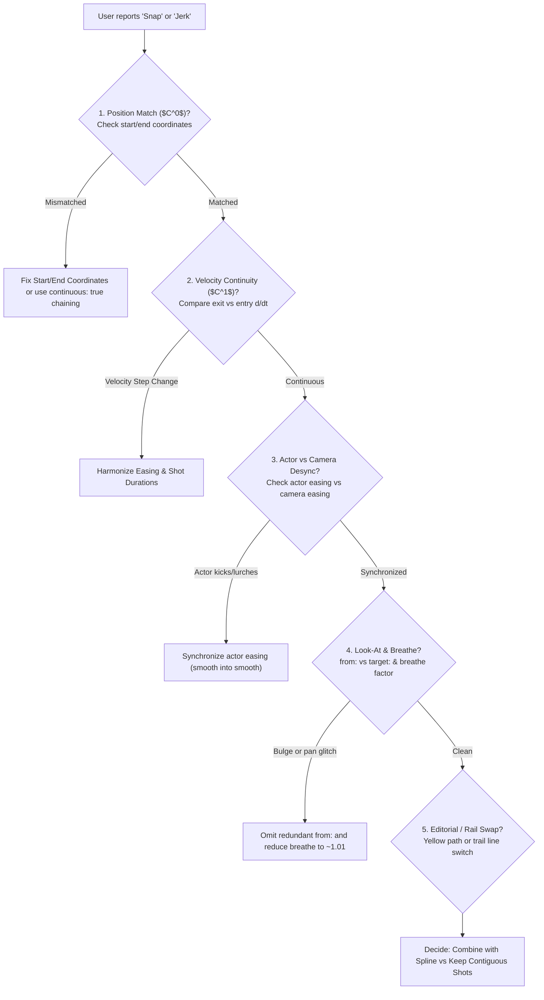

# StageFlow Choreography Score Debugger Skill

This skill guides the agent in systematically inspecting, mathematically auditing, and smoothing StageFlow YAML scores (`*.yaml`).

---

## 1. Diagnostic Decision Tree: The 5 Culprits of a "Snap"

When a user reports a visual snap, hitch, or jerk across shot boundaries, check these 5 areas in order:



---

## 2. Step-by-Step Diagnostic Runbook

### Step 1: Run Microsecond Boundary Sampling
Never guess. Inspect mathematical continuity by evaluating `computeStageFrame(t, score)` at $t_{\text{cut}} - 0.1\text{s}$, $t_{\text{cut}} - 0.01\text{s}$, $t_{\text{cut}}$, $t_{\text{cut}} + 0.01\text{s}$, and $t_{\text{cut}} + 0.1\text{s}$:

```typescript
import { computeStageFrame } from './src/core/frameEngine';
import { parseStageScore } from './src/core/scoreParser';

const testTimes = [tCut - 0.1, tCut - 0.01, tCut, tCut + 0.01, tCut + 0.1];
for (const t of testTimes) {
  const frame = computeStageFrame(t, score);
  const sc = frame.stageCamera.transform;
  const entity = frame.entitiesById.get(activeActorId);
  console.log(`t=${t.toFixed(3)}s [${frame.activeShot?.id}]: Cam.eye=[${sc.position.x.toFixed(3)}, ${sc.position.y.toFixed(3)}, ${sc.position.z.toFixed(3)}], dist=${sc.pose.distance.toFixed(3)}, pitch=${(sc.pose.pitch * 180 / Math.PI).toFixed(1)}°, yaw=${(sc.pose.yaw * 180 / Math.PI).toFixed(1)}°, Actor.x=${entity?.position.x.toFixed(3)}`);
}
```

### Step 2: Audit Derivative Discontinuities ($C^1$ Velocity Check)
Compute normalized time progress rate:
$$\frac{du}{dt} = \left.\frac{du}{dt_{\text{raw}}}\right|_{\text{boundary}} \times \frac{1}{\Delta T_{\text{shot}}}$$

* **Easing Derivatives at Boundaries**:
  * `smooth`: Starts at $0$, peaks at $\frac{\pi}{2} \approx 1.57$, ends at $0$.
  * `linear`: Constant $1.0$ throughout.
  * `accel`: Starts at $0$, ramps to $1.25$ over first $40\%$, finishes at constant $1.25$.
  * `deccel`: Starts at constant $1.25$ for first $60\%$, ramps down to $0$.
  * `cruise`: Starts at $0$, constant $1.33$ in middle $50\%$, ramps down to $0$.
  * `ease-out`: Starts at **peak velocity ($3.0$)**, ramps down to $0$. *(High risk of actor lurching if placed after a stop!)*
  * `ease-in`: Starts at $0$, finishes at **peak velocity ($3.0$)**.

If $\Delta T_{\text{shot 1}} \neq \Delta T_{\text{shot 2}}$, the factor $\frac{1}{\Delta T}$ causes an instant velocity step even if the easing type is identical!

### Step 3: Audit Actor Kinematics vs. Camera Motion
* **Stop-then-Lurch Pattern**: Does the actor come to a stop in Shot 1 (`cruise` / `smooth`) and then immediately use `ease-out` in Shot 2?
  * **Fix**: Change Shot 2 actor easing to `smooth` so both actor and camera accelerate together from rest.
* **Continuous Walk Across Multiple Camera Cuts**: Does the actor walk continuously across multiple shots?
  * **Best Fix**: Extract the actor's movement into a decoupled root-level `blocking:` cue spanning the full duration of the walk (`start` to `end`) so the actor moves along a single continuous easing curve (`cruise` or `smooth`) with a unified Option A ground movement trail while `shots:` cuts freely around them.
  * **Legacy Per-Shot Fix**: Use matching constant velocity (e.g. `accel` in Shot 1 entering constant speed, and `deccel` in Shot 2 beginning at that same constant speed).

### Step 4: Audit Camera Maneuver & Look-At Semantics
* **Redundant `from:`**: In StageFlow, `from:` is intended for smoothly swinging camera look-at *from one entity to a different entity or position*. If both shots track the same entity, omit `from:`.
* **Arc Bulging (`breathe`)**: In `maneuver: "arc"` or `"swoop"`, the default `breathe: 1.12` creates a $+12\%$ radial bulge. For tight follow shots, tame `breathe` to `1.01` or `1.0`.

### Step 5: Evaluate Spline vs. Contiguous Shots vs. Decoupled `blocking:`
When considering merging shots into a single Catmull-Rom spline (`maneuver: "spline"`):
* **Camera Benefit**: Guarantees unbroken $C^1$ path and velocity continuity; keeps a single 3D yellow trajectory rail.
* **Decoupling Actor Beats via `blocking:`**: By authoring actor movements in root `blocking:` with independent `[start, end]` windows, you can combine camera shots into a single `spline` while giving actors multi-phase staging beats (e.g. walk up from `0..5s`, pause from `5..7s`, then turn from `7..10s`), or conversely cut across multiple shots while an actor executes a single continuous cross.

---

## 3. Cinematography Smoothing Cheat-Sheet

| Problem | Root Cause | Solution |
| :--- | :--- | :--- |
| **Actor stops/restarts at every camera cut** | Actor walk is split across `shots[].entities` | Move actor choreography to root-level `blocking:` spanning the full walk window |
| **Actor lurches across boundary** | Actor uses `ease-out` entering at $3\times$ speed after resting | Change actor easing to `smooth` or use a single `blocking:` cue |
| **Camera pushes backward mid-arc** | Default `breathe: 1.12` bulges outward | Set `breathe: 1.0` or `1.01` |
| **Camera jerks across boundary** | Mismatched easing derivatives or durations | Harmonize easing curves (`smooth` into `smooth` or matched $\frac{du}{dt}$) |
| **3D trajectory rail swaps abruptly** | Visual consequence of discrete editorial shots | Combine camera shots with `maneuver: "spline"` and stage actors in `blocking:` |
| **Look-at snaps diagonally** | Target entity switched without `from:` | Add `from: "<previous_target>"` |
