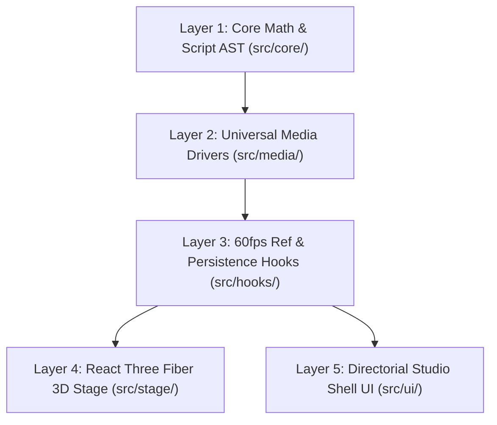

# StageFlow

<p align="center">
  
  
</p>

<p align="center">
  <strong>An Interactive 3D Blueprint Stage & Code-First Choreography Sketchbook</strong><br />
  <em>An interactive diorama to explore, dissect, and understand camera blocking and scene choreography.</em>
</p>

<p align="center">
  <a href="https://github.com/taruma/stageflow/releases"></a>
  <a href="LICENSE"></a>
  <a href="https://github.com/taruma/stageflow"></a>
  <a href="https://www.typescriptlang.org/"></a>
  <a href="https://react.dev/"></a>
  <a href="https://threejs.org/"></a>
  <a href="https://stageflow.taruma.my.id"></a>
</p>

<p align="center">
  <a href="https://stageflow.taruma.my.id"><strong>🌐 Live Studio</strong></a> •
  <a href="docs/YAML_AUTHORING_GUIDE.md"><strong>📖 YAML Guide</strong></a> •
  <a href="docs/STAGEFLOW_SCRIPT_SPECIFICATION.md"><strong>📐 Script Specification</strong></a> •
  <a href="docs/SCORE_CATALOG.md"><strong>🎬 Score Catalog</strong></a> •
  <a href="docs/VIEWPORT_RECORDER_GUIDE.md"><strong>📹 Recorder CLI</strong></a>
</p>

---

## What is StageFlow?

**StageFlow** is an open-source, web-based 3D choreography diorama that synchronizes reference video (**Local `.mp4`/`.webm`**, **YouTube URLs**, or a built-in **60fps Stage Cam Simulator**) side-by-side with an interactive Three.js blueprint stage. 

It lets you visualize where performers stand, how they move, where the physical camera is placed, which focal length is mounted, and where the lens is focused at every millisecond of a scene.

https://github.com/user-attachments/assets/13aa4d0c-ff44-4236-a904-00c7f1f49dde

---

## Why I Built This

> *"What does it actually mean to block a scene? How do camera moves, lens focal lengths, and performer staging interact to create meaning?"*

StageFlow was born out of genuine curiosity: a desire to slow down favorite scenes, deconstruct spatial relationships, and understand how camera work and choreography tell stories on screen.

Rather than focusing on heavy production pipelines or photorealistic rendering, StageFlow keeps things simple and focused:

* **Study Over Production**: A lightweight diorama designed to deconstruct movie scenes and explore *why* a shot was set up a certain way.
* **Choreography as Code**: Authoring staging in clean, human-readable YAML rather than wrestling with complex 3D drag-and-drop gizmos.
* **Minimalist Spatial Clarity**: Stripping away visual clutter to highlight pure spatial relationships—sightlines, focal planes, ground footprints, and camera trajectories.

---

## Key Capabilities (A Visual Sequence)

StageFlow's visual experience follows the natural rhythm of staging a scene:

1. 🖥️ **3-Column Resizable Studio & Live YAML**: A tactile 30/40/30 workspace with reference video, 3D blueprint stage, and CodeMirror 6 YAML editor with 1-click `[ Jump ]` error diagnostics and 4 app themes.
2. 🎬 **Synchronized Reference Video**: Watch real film footage (or procedural camera slates) playing alongside the 3D diorama. Playback stays locked to the exact millisecond with zero drift, single-frame stepping (`[` / `]`).
3. 🚶 **Directional Mannequins & Ground Footprints**: See performers represented on the diorama floor with directional gaze arrows, proportional dimensions, and shape-matched ground footprints that shift smoothly as actors walk, stop, or sit.
4. 🎥 **Rectangular Frustums & Physical Camera Rigs**: See the camera's physical place in the space. The camera projects a true rectangular film gate cone (`16:9`, `2.39:1`) matching full-frame prime lenses (`24mm`–`85mm`), mounted on visible blueprint tripods, linear dolly rails, or curved tracks.
5. 🔍 **Visual Focus Planes & Real-Time Bokeh Blur**: See the focal plane represented as a sliding frame in 3D space. Track dynamic rack focus between performers with an emerald focus tether, and toggle real-time single-pass WebGL2 viewfinder bokeh blur (`[ Blur ]` / hotkey `B`) to see the shot through the camera's optical eye.
6. ⏱️ **Millisecond Scrubbing & Free 3D Inspection on Pause**: Scrub across the timeline with immediate visual feedback. Whenever playback is paused, the diorama automatically hands over to free 3D orbit controls—letting you freely rotate, pan, and inspect the frozen staging from any angle before cutting instantly to the camera's perspective.

---

## Choreography as Code

StageFlow scripts are authored in clean, human-readable YAML. The engine converts high-level directorial notes into exact spatial positions:

```yaml
version: "1.0"
title: "Classic Two-Shot Dolly Glide"
duration: 12.0
fps: 24

entities:
  - id: detective
    kind: character
    position: [-1.2, 0, 0]
    facing: 90
  - id: witness
    kind: character
    position: [1.2, 0, 0]
    facing: -90

shots:
  - id: shot_01
    start: 0.0
    end: 6.0
    camera:
      lens: 35mm
      target: ["detective", "witness"]
      distance: 3.2m
      focus: ["detective", "witness"]
      dof: shallow
      rig:
        type: track
        from: [-2.0, 1.2, 3.0]
        to: [1.0, 1.2, 3.0]
```

> 📖 For full syntax, enum aliases, and recipes, see the [**YAML Authoring Guide**](docs/YAML_AUTHORING_GUIDE.md).

---

## Studio Hotkeys

| Hotkey | Directorial Action | Description |
| :--- | :--- | :--- |
| `Space` | **Play / Pause** | Automatically unlocks `OrbitControls` for free 3D inspection on pause |
| `[` / `]` | **Step 1 Frame** | Precise single-frame backward / forward stepping |
| `←` / `→` | **Scrub Timeline** | Jump 1s backward / forward (Hold `Shift` for 5s jumps) |
| `B` | **DoF Bokeh Blur** | Toggle single-pass WebGL2 Stage Cam viewfinder depth-of-field blur |
| `G` | **Framing Guides** | Toggle rule-of-thirds and safe-action composition overlays |
| `L` | **3D Label Mode** | Cycle mannequin label display (`all` $\to$ `key` $\to$ `off`) |
| `?` | **About & Shortcuts** | Open the About StageFlow info modal and documentation links |

---

## Quickstart

### Prerequisites
* [Node.js](https://nodejs.org/) (v20+ recommended, v18+ supported)
* Modern web browser with WebGL2 support
* [FFmpeg](https://ffmpeg.org/) (optional, required only for headless video recording)

### Installation & Development
```bash
# 1. Clone the repository
git clone https://github.com/taruma/stageflow.git
cd stageflow

# 2. Install dependencies
npm install

# 3. Start local development studio
npm run dev
```

Open `http://localhost:5173` in your browser.

---

## Available Commands

| Command | Task | Description |
| :--- | :--- | :--- |
| `npm run dev` | **Local Studio** | Starts Vite development server at `localhost:5173` |
| `npm test` | **Unit Test Suite** | Runs 258 deterministic unit tests via Vitest |
| `npm run build` | **Typecheck & Bundle** | Strict TypeScript check (`tsc -b`) and Vite production build |
| `npm run lint` | **Code Linter** | Ultra-fast static analysis via `oxlint` |
| `npm run record` | **Viewport Recorder** | Records 60fps video via headless Playwright + FFmpeg |
| `npm run record:batch` | **Batch Recorder** | Renders all 7 factory blueprints across both camera views |

> 📹 For full CLI recording options, resolutions, codecs, and recipes, see the [**Viewport Video Recorder Guide**](docs/VIEWPORT_RECORDER_GUIDE.md). For quick client-side exports without Node/FFmpeg, use **`File ▾ → Export Video (.mp4)...`** directly in the studio (supports **Stage Cam POV**, **16:9 Observer Diorama**, and **Custom (s)** time ranges).

---

## 5-Layer Decoupled Architecture

StageFlow enforces a strict one-way dependency rule (`core/` $\to$ `media/` $\to$ `hooks/` $\to$ `stage/` & `ui/`). `src/core/` contains **zero React and zero DOM/Three.js runtime dependencies**.



### Living Documentation Suite (Single Source of Truth)

* [**`AGENTS.md`**](AGENTS.md) — Engineering governance, non-negotiable invariants, and development rules.
* [**`CHANGELOG.md`**](CHANGELOG.md) — Keep-a-Changelog release history and version tracking.
* [**`docs/ARCHITECTURE_FILE_MAP.md`**](docs/ARCHITECTURE_FILE_MAP.md) — Exhaustive file-by-file repository tree and 5-layer index.
* [**`docs/STAGEFLOW_SCRIPT_SPECIFICATION.md`**](docs/STAGEFLOW_SCRIPT_SPECIFICATION.md) — Mathematical and kinematic specifications (analytical curve equations, normalized AST contract).
* [**`docs/CORE_MATH_AND_SCORE_SPECIFICATIONS.md`**](docs/CORE_MATH_AND_SCORE_SPECIFICATIONS.md) — Layer 1 stateless timeline math ($Frame_t = f(t)$), coordinate systems, and lens optics.
* [**`docs/MEDIA_CLOCK_AND_SYNC_SPECIFICATIONS.md`**](docs/MEDIA_CLOCK_AND_SYNC_SPECIFICATIONS.md) — Layer 2 & 3 media clock drivers, YouTube drift extrapolation, and dual-tier 60fps/10Hz loop.
* [**`docs/DIORAMA_3D_AND_UI_SPECIFICATIONS.md`**](docs/DIORAMA_3D_AND_UI_SPECIFICATIONS.md) — Layer 4 & 5 3D blueprint stage, dual-camera handover, and workspace UI chrome.
* [**`docs/VISUAL_DESIGN_SYSTEM.md`**](docs/VISUAL_DESIGN_SYSTEM.md) — Typography (`Inter`, `Libre Baskerville`, `JetBrains Mono`), theme engine, and color palettes.
* [**`docs/SCORE_CATALOG.md`**](docs/SCORE_CATALOG.md) — Master catalog of bundled scene studies and educational blueprints.
* [**`docs/VIEWPORT_RECORDER_GUIDE.md`**](docs/VIEWPORT_RECORDER_GUIDE.md) — Playwright + FFmpeg viewport video recorder reference and production recipes.

---

## Tech Stack

* **Core Math & Kinematics**: Pure TypeScript, `yaml` AST parser, spherical coordinate kinematics
* **3D Graphics & Canvas**: [Three.js](https://threejs.org/) (r175), [React Three Fiber](https://r3f.docs.pmnd.rs/) (v9), [@react-three/drei](https://github.com/pmndrs/drei) (v10)
* **Directorial Studio UI**: [React 19](https://react.dev/), [Tailwind CSS v4](https://tailwindcss.com/), [Lucide React](https://lucide.dev/), [CodeMirror 6](https://codemirror.net/)
* **Media & Audio Engine**: HTML5 Video, YouTube IFrame API (60fps extrapolation), Web Audio API
* **State & Persistence**: [IndexedDB (`idb`)](https://github.com/jakearchibald/idb), `localStorage`
* **Headless Video Export**: [Playwright](https://playwright.dev/) (Chromium), [FFmpeg](https://ffmpeg.org/)
* **Quality & Tooling**: [Vitest](https://vitest.dev/) (258 deterministic tests), [oxlint](https://oxc.rs/)

---

## Author & Sister Projects

* **Created by**: **Taruma Sakti** ([@taruma](https://github.com/taruma))
* **AI Pair Programming**: Built inside **Google Antigravity**, utilizing **Gemini 3.8 Flash** and **Gemini 4 Argon** (used heavily for initial codebase scaffolding and mathematical kinematic equations).
* **Sister Suite Project**: [**SceneFlow**](https://github.com/taruma/screenplay-sync) — Collaborative screenplay and timing alignment studio.
* **Attribution**: If StageFlow inspires your project, study, or video, a shout-out or link back to [github.com/taruma/stageflow](https://github.com/taruma/stageflow) is always appreciated!

> [!WARNING]
> **Vibe-Coded Disclaimer**: This software was born through exploratory "vibe coding" and rapid experimental iterations. As such, the code may contain bugs, experimental behaviors, or breaking quirks. Use at your own risk!

---

## License

This project is licensed under the [MIT License](LICENSE).
